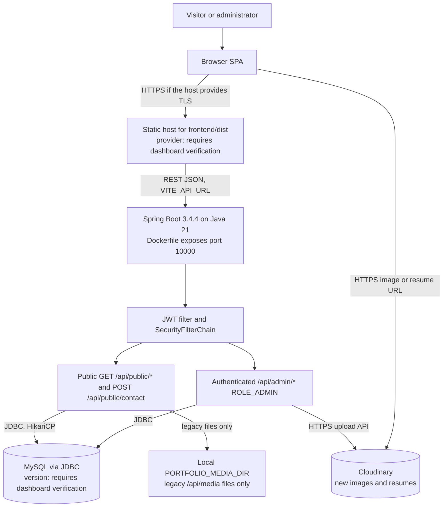
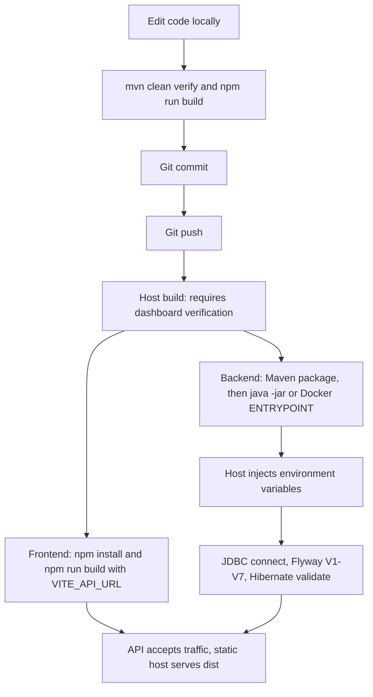
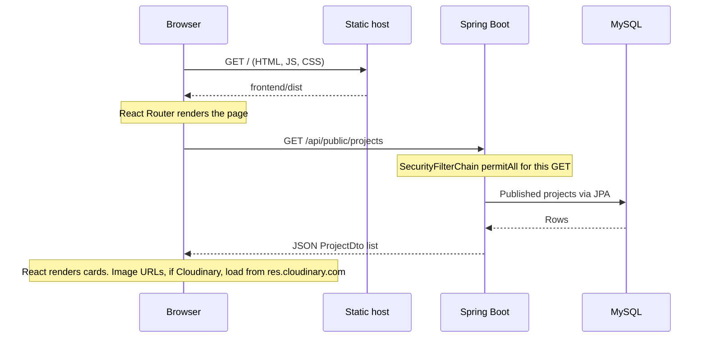
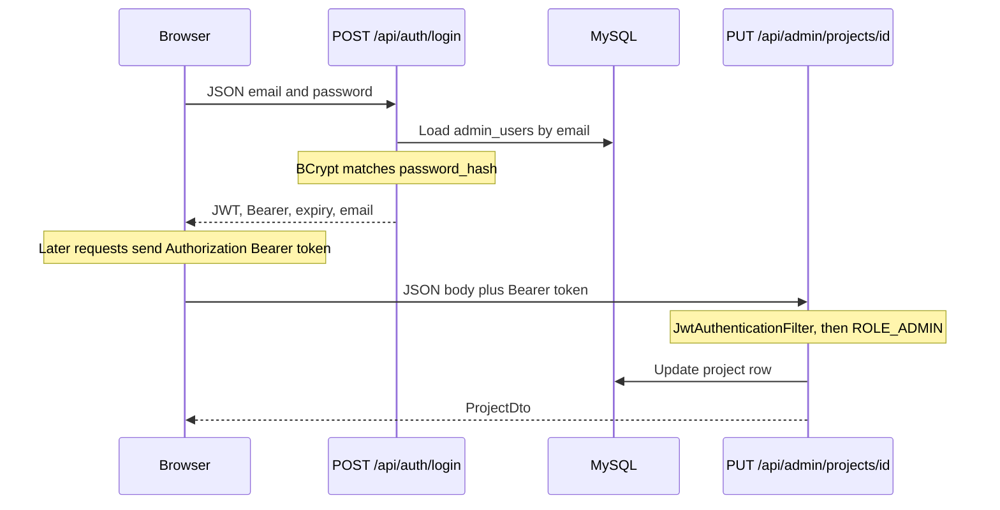
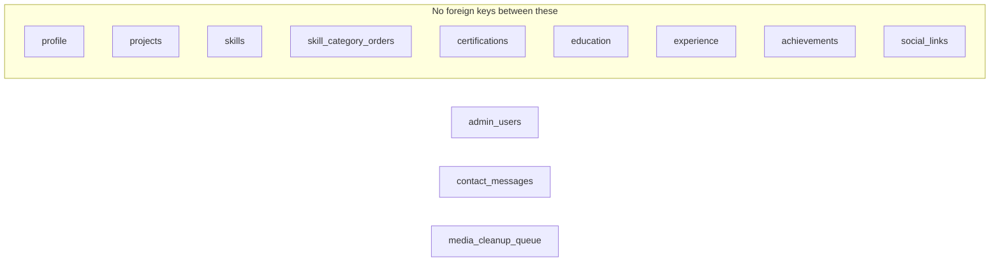

# Deployment Architecture Sheet

Full-stack developer portfolio: React 19, TypeScript, Vite, Spring Boot 3.4.4, Java 21, MySQL, Flyway, JWT.

**Document status:** Corrected against the repository on 2026-10-15. Claims below are from source inspection unless marked **Requires deployment-dashboard verification**. Nothing in this file was confirmed by connecting to a live host or database.

**Evidence:** `backend/pom.xml`, `frontend/package.json`, `backend/src/main/resources/application.properties`, Flyway scripts `V1`–`V7`, `SecurityConfig`, `JwtUtil`, `AdminBootstrap`, `ContactController`, `StorageUtil`, `CloudinaryStorageService`, `ResumeController`, `backend/Dockerfile`.

---

## Contents

1. [What is actually implemented](#1-what-is-actually-implemented)
2. [Runtime architecture](#2-runtime-architecture)
3. [Technology reference](#3-technology-reference)
4. [How the application starts](#4-how-the-application-starts)
5. [Deployment lifecycle](#5-deployment-lifecycle)
6. [Request and login sequences](#6-request-and-login-sequences)
7. [Database and file storage](#7-database-and-file-storage)
8. [Security](#8-security)
9. [Hosting and reliability](#9-hosting-and-reliability)
10. [Troubleshooting](#10-troubleshooting)
11. [Architecture decisions](#11-architecture-decisions)
12. [Recommended improvements](#12-recommended-improvements)

---

## 1. What is actually implemented

| Area | Verified in source | Not verified from this repository |
|---|---|---|
| Frontend | React 19, TypeScript ~6, Vite 8, Tailwind CSS 4, Framer Motion, Axios, React Router 7, React Hook Form, Zod | Hosting provider, custom domain, HTTPS termination |
| Backend | Spring Boot 3.4.4, Java 21, Maven JAR, Dockerfile on port 10000 | Which platform builds the image, region, plan, start command used in production |
| Database | JDBC URL targets MySQL; Hibernate dialect is `MySQLDialect`; Flyway `V1`–`V7` | Server version. **MySQL 8.4.11 is not declared anywhere in this repo and requires dashboard verification** |
| Auth | Stateless JWT (JJWT 0.12.6), BCrypt, method security `ROLE_ADMIN` | Token storage lifetime in the browser beyond the 24h default |
| Media | New uploads go to Cloudinary (`cloudinary-http5` 2.3.2). Older `/api/media/{file}` paths can still be served from local disk | Whether production Cloudinary credentials are set |
| CI / monitoring | Git is the version-control system | No GitHub Actions workflow, Dockerfile-triggered pipeline, UptimeRobot config, or Actuator dependency exists in the repo |

There is no Three.js (or other WebGL) dependency in `frontend/package.json`. Motion on the public page is Framer Motion. Do not describe a 3D canvas as part of this build.

---

## 2. Runtime architecture



Legend:

- Solid arrows are runtime requests the code actually makes.
- The static host, TLS, and MySQL version are deployment facts. They are not encoded in this repository.
- There is no CDN, object-storage volume, CI runner, or uptime monitor drawn here, because none is configured in source.

Editable copy: [`diagrams/01-runtime.mmd`](diagrams/01-runtime.mmd).

---

## 3. Technology reference

| Tool | Category | Where | Why it is here | What it does in this project | Alternative |
|---|---|---|---|---|---|
| React 19.2 | Frontend | `frontend/package.json` | Component UI with a current React release | Public portfolio and admin screens | Vue, Svelte |
| TypeScript ~6.0 | Frontend | `frontend/package.json` | Compile-time checking of API types | `tsc -b` runs before the Vite production build | Plain JavaScript |
| Vite 8.3 | Build | `frontend/package.json` | Fast dev server and production bundle | `npm run build` emits `frontend/dist` | Webpack |
| Tailwind CSS 4.3 | Styling | `@tailwindcss/vite` | Utility CSS without a separate config framework | Layout and theme classes in components | CSS modules |
| Framer Motion 11 | Animation | Hero, navbar, sections | Declarative enter/exit motion | Fade and slide on the public page. Honors reduced motion where components use it | CSS transitions |
| Axios 1.7 | HTTP client | `frontend/src/api/client.ts` | One place for base URL and auth header | Calls the Spring API | `fetch` |
| React Router 7 | Routing | Frontend pages | Client routes for public and `/admin` views | SPA navigation; the static host must fall back to `index.html` | File-based routers |
| React Hook Form 7 + Zod 3 | Forms | Contact and admin forms | Validate before submit | Client-side form validation. Server Bean Validation is still required | Manual state |
| Java 21 | Runtime | `pom.xml` `java.version` | Current LTS used by the toolchain | Compiles and runs the API | Java 17 |
| Spring Boot 3.4.4 | Backend | `pom.xml` parent | Embedded server, DI, configuration | JAR started by `java -jar` or the Dockerfile | Quarkus |
| Spring Security | Security | `SecurityConfig` | Filter chain instead of ad-hoc checks | CORS, stateless sessions, public vs authenticated routes | Hand-rolled filters only |
| JJWT 0.12.6 | Tokens | `JwtUtil` | Sign and parse JWTs without servlet sessions | HMAC token for admin email | Opaque server sessions |
| BCrypt | Passwords | `BCryptPasswordEncoder` bean | Slow password hash | `AdminBootstrap` stores `password_hash`; login verifies it | Argon2 |
| Spring Data JPA | Persistence | `repository/` | Repositories over entities | CRUD for portfolio tables | jOOQ |
| MySQL Connector/J | Database driver | `pom.xml` (Boot-managed 8.4.x line in comments) | JDBC driver | Connects using `DB_HOST`, `DB_PORT`, `DB_NAME`, `DB_USER`, `DB_PASSWORD` | MariaDB driver |
| Flyway | Migrations | `db/migration`, `flyway-mysql` | Versioned SQL | Runs `V1`–`V7` on startup. `ddl-auto=validate` | Liquibase |
| Cloudinary HTTP5 2.3.2 | Media | `CloudinaryStorageService` | Uploads survive a container rebuild | New images and résumé PDFs | S3, persistent disk |
| Spring Mail | Email | `ContactEmailService`, `spring-boot-starter-mail` | Optional SMTP notify on contact submit | Sends only when mail properties are set | No email |
| Maven | Build | `pom.xml`, Dockerfile | Reproducible JAR | `mvn -B -DskipTests clean package` inside the image | Gradle |
| Docker | Packaging | `backend/Dockerfile` | Run the JAR as a non-root user | Multi-stage Temurin 21 build, listens on `PORT` (default 10000) | A platform buildpack with no Dockerfile |
| Git | Version control | Repository root | History | Source of what gets deployed. Remote hosting of the Git repo is separate from app hosting | — |
| H2 | Tests only | `pom.xml` test scope | Tests without MySQL | Not a production database | Testcontainers MySQL |

Not in this repository: Three.js, GitHub Actions, Spring Boot Actuator, Swagger/OpenAPI (the security config permits `/v3/api-docs` and `/swagger-ui/**`, but no springdoc dependency or controller exists), UptimeRobot.

---

## 4. How the application starts

### Frontend

Development and production are different commands.

| | Development | Production |
|---|---|---|
| Command | `npm run dev` (`vite`) | `npm run build` (`tsc -b && vite build`) |
| Result | Dev server, Vite default port 5173 | Static files in `frontend/dist` |
| API URL | `VITE_API_URL` at dev-server start | `VITE_API_URL` baked in at **build** time. It is public in the JS bundle |
| Who serves it | Vite | Whatever static host you configure. **Requires deployment-dashboard verification** |

`VITE_*` values are not secrets. Do not put database passwords or the JWT secret there.

### Backend, local JAR

From `application.properties` and `pom.xml`:

```powershell
cd backend
mvn clean package
java -jar target/backend-0.0.1-SNAPSHOT.jar
```

`server.port` is `${PORT:8080}`. With no `PORT` set, the JAR listens on **8080**.

On startup Spring Boot:

1. Reads environment variables into `application.properties` placeholders.
2. Opens a JDBC pool to MySQL. `sslMode=REQUIRED` is in the URL.
3. Runs Flyway (`baseline-on-migrate=true`) then Hibernate `ddl-auto=validate`.
4. `JwtUtil` refuses to start outside the `test` profile if `JWT_SECRET` is blank or contains `CHANGE_ME`.
5. `AdminBootstrap` inserts one admin only when `admin_users` is empty **and** `ADMIN_EMAIL` / `ADMIN_PASSWORD` are set. Later startups do nothing.

A process that is listening is not the same as a healthy database-backed app. If MySQL is down, startup fails before it serves traffic. There is **no implemented health endpoint**: `SecurityConfig` permits `GET /api/health` and `GET /api/actuator/health`, but no controller or Actuator dependency handles those paths, so they fall through as unmapped requests.

### Backend, container

`backend/Dockerfile` (context must be the **repository root**, because it copies `backend/pom.xml`):

```text
docker build -f backend/Dockerfile -t portfolio-backend .
```

The image runs:

```text
java -XX:MaxRAMPercentage=75.0 -Dserver.port=${PORT:-10000} -jar /app/app.jar
```

Inside the container the default port is **10000**, not 8080. `PORTFOLIO_MEDIA_DIR=/app/portfolio-media` is set in the image. That directory is container-local. New uploads do not use it; Cloudinary does. It only matters for legacy `/api/media/...` files, and those files **do not survive** a new container unless a volume is mounted. No volume is declared in the Dockerfile.

Whether production actually uses this Dockerfile, and which start command the host dashboard shows, **requires deployment-dashboard verification**.

### Required configuration

| Name | Process | Required | Notes |
|---|---|---|---|
| `DB_HOST`, `DB_PORT`, `DB_NAME`, `DB_USER`, `DB_PASSWORD` | Backend | Yes in any shared environment | Password has no default |
| `JWT_SECRET` | Backend | Yes except `test` | Placeholder containing `CHANGE_ME` aborts startup |
| `JWT_EXPIRATION_MS` | Backend | No | Default 86400000 |
| `CORS_ALLOWED_ORIGINS` | Backend | Yes for a non-local frontend | Default `http://localhost:5173`. Code reads a single origin via `System.getenv`, not a comma-separated list |
| `CLOUDINARY_CLOUD_NAME`, `CLOUDINARY_API_KEY`, `CLOUDINARY_API_SECRET` | Backend | Yes to upload | Missing values throw when an upload is attempted |
| `PORTFOLIO_MEDIA_DIR` | Backend | Only for legacy local files | Default `./portfolio-media`; image sets `/app/portfolio-media` |
| `ADMIN_EMAIL`, `ADMIN_PASSWORD` | Backend | First boot only if you want automatic admin creation | Ignored once a row exists |
| `PORT` | Backend | Depends on host | 8080 for a bare JAR; 10000 in the image |
| `MAIL_HOST`, `MAIL_PORT`, `MAIL_USERNAME`, `MAIL_PASSWORD`, `MAIL_FROM`, `MAIL_TO` | Backend | No | Contact form still saves when mail is unset |
| `VITE_API_URL` | Frontend build | Yes for production | Public. Example shape: `https://api.example.com/api` |
| `CONTACT_RATE_LIMIT` | — | Unused by the controller | Property default is 5, but `ContactController` calls `isRateLimited(ip, 5)` with a literal |

---

## 5. Deployment lifecycle

What the repository supports:



There is no workflow file under `.github/workflows`. A push does **not** deploy by itself unless a host is configured, outside this repo, to watch the Git remote. That trigger, and any manual "deploy" button, **requires deployment-dashboard verification**.

Frontend and backend are separate artifacts. Shipping only one of them is a valid outcome of a manual deploy and a common source of "the site works, the API does not" or the reverse.

---

## 6. Request and login sequences

### Visitor opens the projects section



The browser never opens a database connection.

### Administrator login and a protected write



`JwtUtil.generateToken` puts the email in the subject and signs with HMAC-SHA using `JWT_SECRET`. It does not put a role claim in the token. Role enforcement is `@PreAuthorize("hasRole('ADMIN')")` on admin controllers plus `.anyRequest().authenticated()` in `SecurityConfig`. How the role is attached to the authenticated principal is in `JwtAuthenticationFilter` / `AdminUserService`; the token itself is not a role document.

Login is not rate-limited in code. Contact submission is.

---

## 7. Database and file storage

### Engine

The app speaks MySQL through Connector/J. `pom.xml` comments say Boot manages `mysql-connector-j` 8.4.x. That is the **driver**, not the server. A production server of 8.4.11 is a plausible match for that driver and is **not** something this repository can prove. Confirm the version in the database host's dashboard.

Tests use H2 and do not prove production MySQL behavior.

### Tables created by Flyway

`V1__initial_schema.sql` creates ten tables:

`admin_users`, `profile`, `projects`, `skills`, `certifications`, `education`, `experience`, `achievements`, `social_links`, `contact_messages`.

Later migrations:

| Script | Change |
|---|---|
| `V2__seed_data.sql` | Seed rows, not schema |
| `V3__cert_image_url.sql` | Image URL column on certifications |
| `V4__achievement_image_url.sql` | Image URL column on achievements |
| `V5__skill_category_order.sql` | `skill_category_orders` |
| `V6__profile_hero_headline.sql` | `profile.hero_headline` |
| `V7__media_cleanup_queue.sql` | `media_cleanup_queue` for deferred Cloudinary deletes |

That is **12 application tables** after `V7` (10 in `V1`, plus `skill_category_orders`, plus `media_cleanup_queue`). Flyway also creates `flyway_schema_history`. Eleven JPA entities match the content tables. `media_cleanup_queue` has no entity; the cleanup service writes it directly.

There are no foreign keys in `V1` or `V7`. Profile is a singleton row. Projects, skills, certifications, education, experience, achievements, and social links are independent lists ordered by `sort_order`. Skill category order is a separate table keyed by category name. Contact messages and admin users do not reference other tables. `media_cleanup_queue.asset_url` is a URL string, not a foreign key.



Editable copy: [`diagrams/05-schema.mmd`](diagrams/05-schema.mmd). An ER relationship line would invent a constraint the SQL does not have, so the diagram does not draw one. `skills.category` and `skill_category_orders` share a string only.

### Migrations across deploys

Flyway runs on application startup, not as a separate job. Applied scripts must not be edited; add `V8__...sql`. `baseline-on-migrate=true` marks an existing non-empty database as baselined instead of failing on a missing history table. That is a footgun on a database that already has tables but never ran these scripts. Prefer an empty database for a first production boot.

If MySQL is stopped, the API does not start, or an already-running process loses its pool and requests fail. Restarting MySQL does not by itself delete data. Restarting the **backend container** does not delete MySQL data if the database is a separate service. It does delete files written only to the container filesystem.

### Uploads

| | New images | New résumé | Legacy files |
|---|---|---|---|
| Entry | `POST /api/admin/upload/image` via `StorageUtil.storeImage` | `POST /api/admin/resume` | `GET /api/media/{filename}` |
| Checks | Content-Type allowlist, 5 MB, magic bytes for PNG, JPEG, WebP | Content-Type `application/pdf`, 5 MB, `%PDF` header | Filename must match `[A-Za-z0-9_-]+.(jpg\|jpeg\|png\|webp)` and stay under the media directory |
| Stored at | Cloudinary `portfolio/images/...`, HTTPS URL saved on the entity | Cloudinary `portfolio/resumes/...`, URL saved on the profile | `PORTFOLIO_MEDIA_DIR` on local disk |
| Survives a new container | Yes, if the Cloudinary account remains | Yes, same condition | **No**, unless a volume is mounted. The Dockerfile does not mount one |
| Public read | Browser loads the Cloudinary HTTPS URL | `GET /api/public/resume` redirects to the HTTPS URL | Backend copies the file to the response |

`MediaCleanupService` queues replaced or abandoned Cloudinary URLs in `media_cleanup_queue` and deletes them only after checking they are no longer referenced. A failed database save is not supposed to leave a permanent orphan; that depends on the cleanup job actually running.

Do not commit `backend/.env`, `portfolio-media/`, or `resume-storage/`.

---

## 8. Security

| Control | Status | Evidence |
|---|---|---|
| Password hashing | Implemented | `BCryptPasswordEncoder` bean; `AdminBootstrap` calls `passwordEncoder.encode` |
| JWT issue and check | Implemented | `JwtUtil` HMAC sign/parse; expiry from `app.jwt.expiration-ms` |
| Reject insecure JWT secret | Implemented | `@PostConstruct` throws if secret is blank or contains `CHANGE_ME`, unless profile `test` |
| Admin route protection | Implemented | Class-level `@PreAuthorize("hasRole('ADMIN')")` on `AdminController`; `.anyRequest().authenticated()` |
| Public vs write split | Implemented | GET public content is `permitAll`; other methods require authentication |
| CSRF | Disabled on purpose | Stateless API, no cookie session. Safe only if the token is not in a cookie the browser sends automatically |
| CORS | Implemented, single origin | `CORS_ALLOWED_ORIGINS` or `http://localhost:5173`. Credentials allowed. A comma-separated value is **not** split |
| Contact rate limit | Implemented, fixed at 5/hour/IP | Counts rows in `contact_messages` for that IP since 1 hour ago. `X-Forwarded-For` first hop is trusted |
| Upload validation | Implemented | Type, size, magic bytes, Cloudinary path prefix check before delete |
| Secrets in env vars | Implemented | `.env` is gitignored. Values must still be set on the host |
| JDBC TLS | Requested by the URL | `sslMode=REQUIRED`. Whether the server certificate is verified further **requires dashboard verification** |
| HTTPS for the site | Not in source | TLS is a property of the static host and the API host |
| Security response headers | Not in source | No CSP, HSTS, or frame-options config found |
| Login rate limit | Not implemented | `/api/auth/login` is `permitAll` with no throttle |
| Health check | Not implemented | Routes are permitted and unmapped |
| Actuator / Swagger | Not on the classpath | Permitted paths do not serve those UIs |

"Uses JWT" does not mean stolen tokens can be revoked. They remain valid until `JWT_EXPIRATION_MS`. Logs must not print `JWT_SECRET`, `DB_PASSWORD`, Cloudinary API secret, or `ADMIN_PASSWORD`. `AdminBootstrap` prints the admin **email** on first create; it does not print the password.

---

## 9. Hosting and reliability

| Question | From this repository | Requires deployment-dashboard verification |
|---|---|---|
| Frontend host, plan, custom domain | Not recorded | Yes |
| Backend host, plan, region | Dockerfile is compatible with a container host that sets `PORT` (default 10000) | Yes, including whether this Dockerfile is what production runs |
| MySQL host, version, storage, backups | Driver and URL only | Yes. Do not treat "8.0" or "8.4.11" as a source fact until the dashboard says so |
| Idle sleep / cold start | Not configured in code | Yes, if the plan suspends free instances |
| Disk for legacy media | Ephemeral inside the image | Yes, if a volume was added in the dashboard |
| Cloudinary account limits | Code requires three env vars | Yes |
| Uptime monitor | Not in the repo | Yes, if configured in a third-party UI |
| CI on push | No workflow file | A host webhook would still be outside the repo |

A free plan is not a promise of permanent free hosting or of uptime. Quotas, sleep, and terms sit with the vendor. This repository cannot show them.

Practical checks that do not require new vendors:

- Confirm the frontend build's `VITE_API_URL` points at the API the backend is actually serving.
- Confirm `CORS_ALLOWED_ORIGINS` is exactly one origin, scheme included, no trailing-path surprises.
- Confirm Cloudinary env vars are set anywhere uploads must work.
- Confirm MySQL is a separate service from the API container, and that backups are enabled in that service.
- Do not use the container filesystem as the system of record for uploads.

---

## 10. Troubleshooting

| Symptom | Likely cause | How to verify | Fix | Prevention |
|---|---|---|---|---|
| UI loads, API calls fail | Wrong `VITE_API_URL`, or API down | Browser network tab: host and status of `/api/public/profile` | Rebuild frontend with the real API origin, or start the API | Build-time env review |
| CORS error | Origin not equal to `CORS_ALLOWED_ORIGINS` | Response headers on the failing request | Set the env var to the exact frontend origin and restart the API | One origin, documented |
| API returns 500 | Uncaught exception, often database or Cloudinary | API logs for the request | Fix the exception named in the log. Do not guess | Log review on deploy |
| API will not start, JWT message | `JWT_SECRET` missing or still the placeholder | Startup log `CRITICAL SECURITY ERROR` | Set a real secret and restart | No default secret in production |
| API will not start, communications link failure | MySQL host, port, user, password, or server down | Logs plus the database host's status page | Restore the database service or correct `DB_*` | Separate DB health from app health |
| Flyway checksum or validation error | Edited applied migration, or schema drift | Flyway log names the version | Add a new migration. Do not edit `V1`–`V7` | Never change applied SQL |
| Port already in use | Local 8080, or `PORT` clash | OS socket listing | Stop the other process or set `PORT` | Know 8080 vs 10000 |
| Upload returns 500 mentioning Cloudinary | The three `CLOUDINARY_*` vars are unset | Startup is fine; failure is on upload | Set them on the API host and restart | Required-var checklist |
| Old images 404 after redeploy | Legacy files lived on container disk | URLs starting with `/api/media/` | Re-upload so the entity stores a Cloudinary URL | Stop writing new files to local disk |
| Login 401 | Wrong password, or no admin row | `admin_users` count, without printing the hash | Set `ADMIN_EMAIL` / `ADMIN_PASSWORD` only on an **empty** table, or reset the hash in SQL | Bootstrap runs once |
| Admin 401/403 after login | Missing `Authorization: Bearer`, or principal has no `ROLE_ADMIN` | Request header and filter logs | Send the token from login; confirm `AdminUserService` loads the user | Client auth interceptor |
| Contact 429 | 5 saved messages from that IP in the last hour | Rows in `contact_messages` | Wait, or delete test rows | The limit is not the unused `CONTACT_RATE_LIMIT` property |
| "Health" URL 404 or 500 | No handler | `GET /api/health` | Do not point a monitor at it until a real handler exists | See recommended improvements |
| Stale UI after a good API deploy | Old static assets cached | Response age / file hashes in `dist` | Redeploy `frontend/dist` and bypass cache | Frontend and backend are separate deploys |

---

## 11. Architecture decisions

Format: decision, reason, benefit, trade-off, alternative, when to reconsider. Items inferred from the code rather than from a written ADR are marked.

**Separate React app and Spring Boot API.** Reason: two deployable artifacts. Benefit: UI and API can ship separately. Trade-off: CORS, two builds, `VITE_API_URL` frozen at frontend build time. Alternative: server-rendered templates. Reconsider if you no longer want a public JSON API. *(Inferred.)*

**MySQL.** Reason: relational rows with a JDBC URL and Flyway SQL. Benefit: boring, inspectable data. Trade-off: you operate a database service. Alternative: embedded SQL or a document store. Reconsider only if the data model stops being rows. *(Inferred; server version is not chosen in git.)*

**REST JSON.** Reason: Axios client and Spring `@RestController` methods. Benefit: easy to test with HTTP. Trade-off: no typed contract generated from code (springdoc is not on the classpath). Alternative: generated OpenAPI client. Reconsider when the API surface grows.

**JWT, stateless.** Reason: `SessionCreationPolicy.STATELESS` and `JwtUtil`. Benefit: no server session store. Trade-off: no revocation before expiry; CSRF disabled because the token must not be an automatic cookie. Alternative: server sessions. Reconsider if you need instant logout.

**Flyway plus `ddl-auto=validate`.** Reason: SQL in git is the schema; Hibernate only checks it. Benefit: production does not auto-alter tables. Trade-off: every column change needs a migration. Alternative: `ddl-auto=update` (unsafe here). Do not reconsider for production.

**Cloudinary for new media.** Reason: `CloudinaryStorageService` uploads and returns `https://` URLs. Benefit: files outlive the API container. Trade-off: a third-party account, three secrets, and cleanup logic. Alternative: a mounted volume or S3. Reconsider if you cannot use a vendor or need the files in a private network.

**Dockerfile for the API only.** Reason: `backend/Dockerfile` packages the JAR. Benefit: one start command for a container host. Trade-off: build context is the repo root; port default changes from 8080 to 10000; local media is ephemeral. Alternative: the host's native Java buildpack. Reconsider if the host ignores Dockerfiles.

**No CI workflow in git.** This is the current state, not a recommended decision. Deploys are manual or configured outside the repository.

---

## 12. Recommended improvements

Not implemented. Do not document these as current behavior.

- A real `GET /api/health` that checks the database, if a host needs a probe.
- Remove or implement the permitted Swagger and Actuator matchers so they are not a false signal.
- Honor `app.contact.rate-limit` instead of the literal `5`, and do not trust `X-Forwarded-For` unless the proxy is known.
- Login throttling.
- A GitHub Actions workflow that runs `mvn clean verify` and `npm run build` on pull requests. That still would not deploy unless you add a deploy job.
- Split `CORS_ALLOWED_ORIGINS` on commas if more than one origin is ever required.
- Persist nothing important on the container disk; legacy `/api/media` files should be re-uploaded to Cloudinary.
- Screenshots and a live URL in the root README only after they exist.

---

## Glossary

| Term | Meaning here |
|---|---|
| Artifact | `frontend/dist` or `backend/target/backend-0.0.1-SNAPSHOT.jar` |
| Bake time | When `VITE_API_URL` is compiled into the frontend |
| Legacy media | URL path `/api/media/...` served from disk |
| Managed asset | Cloudinary URL under this account's `portfolio/images` or `portfolio/resumes` prefix |
| Requires deployment-dashboard verification | Cannot be proven from git |
