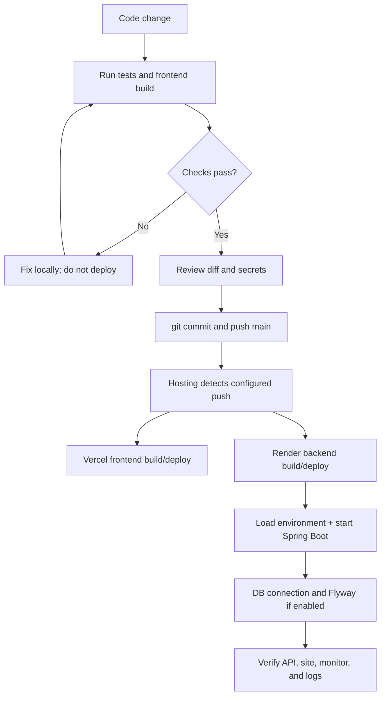
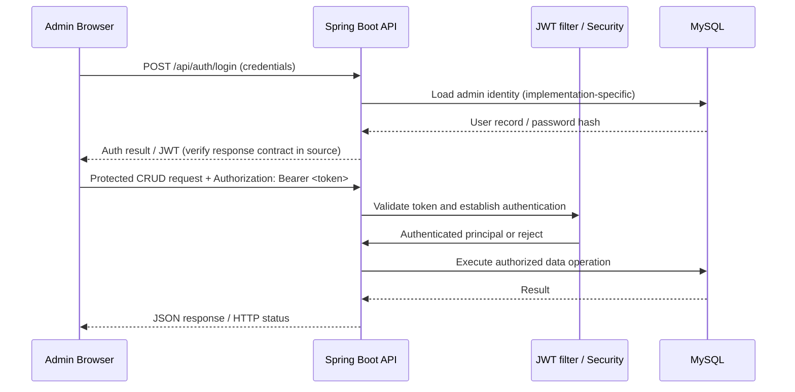

# Portfolio Website — Deployment Architecture & Operations Guide

> **Scope and confidence:** The deployed architecture below is grounded in confirmed project history and the supplied `SecurityConfig.java`. Complete repository and dashboard access was unavailable during this documentation run. Anything that depends on hidden source files or dashboard settings is explicitly marked **Confirm**.

**Live frontend:** <https://yashganorkardev.vercel.app/>  
**Backend API:** <https://portfolio-backend-y9yf.onrender.com>  
**Public profile endpoint:** <https://portfolio-backend-y9yf.onrender.com/api/public/profile>  
**Source repository:** <https://github.com/yashganorkar005/developer-portfolio>

## Contents

1. [Executive overview](#1-executive-overview)
2. [Technology reference](#2-technology-reference)
3. [How the application builds and starts](#3-how-the-application-builds-and-starts)
4. [Deployment lifecycle](#4-deployment-lifecycle)
5. [Public request sequence](#5-public-request--recruiter-opens-the-projects-section)
6. [Administrator authentication and CRUD](#6-administrator-login-and-protected-operations)
7. [Database and media architecture](#7-database-and-filemedia-architecture)
8. [Security review](#8-security-architecture-review)
9. [Hosting reliability and free-tier limits](#9-hosting-and-reliability)
10. [Troubleshooting](#10-troubleshooting-table)
11. [Architecture decision records](#11-architecture-decision-record-adr-style)
12. [Glossary and evidence](#12-glossary), [references](#13-evidence-and-source-references)

## 1. Executive overview

This is a split frontend/backend portfolio application:

- **Vercel** serves the built React/Vite frontend over HTTPS.
- The frontend makes HTTPS REST/JSON requests to the **Spring Boot** backend on **Render**.
- The backend applies Spring Security rules, invokes controller/service/repository code, and accesses **MySQL on Aiven** over JDBC/TLS.
- New/replaced images and the resume are handled through **Cloudinary**; the backend keeps Cloudinary credentials server-side. A complete migration of older local media was intentionally skipped, so legacy URL references still deserve a verification pass.
- Contact messages are saved to the database, then the backend attempts to send a notification through the **Brevo HTTPS API**. Email failure does not undo a message already saved in MySQL.
- GitHub is the source of truth for versioned code. Pushes have historically led to deployments; exact Vercel/Render branch and auto-deploy settings should be confirmed in their dashboards.
- UptimeRobot monitors the Render public profile endpoint. A HEAD request returned `200 OK` in the supplied terminal output after commit `379c312`; confirm that the monitor's event is now resolved.

```mermaid
flowchart LR
  Visitor[Recruiter / Visitor Browser] -->|HTTPS| Vercel[Vercel: React + TypeScript + Vite static build]
  Admin[Administrator Browser] -->|HTTPS| Vercel
  Vercel -->|HTTPS REST / JSON| Render[Render: Java + Spring Boot REST API]
  Render -->|JDBC over TLS / SQL| Aiven[(Aiven MySQL 8.4.11)]
  Render -->|HTTPS upload / delivery URLs| Cloudinary[Cloudinary media storage/CDN]
  Render -->|HTTPS transactional email API| Brevo[Brevo email API]
  Uptime[UptimeRobot] -->|HTTP(S) HEAD monitor| Render
  GitHub[GitHub: main branch] -. push / deploy trigger .-> Vercel
  GitHub -. push / deploy trigger .-> Render
```

> **Diagram boundary:** The Vercel and Render URLs, MySQL engine/provider, Cloudinary/Brevo integrations, UptimeRobot monitor, and frontend/backend stack are established from the project history. Exact repository integration settings and network/TLS implementation details should be checked in the provider dashboards and runtime logs.

## 2. Technology reference

| Tool / Technology | Category | Where It Is Used | Why It Is Used in This Project | Alternatives / Verification |
|---|---|---|---|---|
| React | Frontend UI | Public pages and admin interface | Component-based pages and reusable UI elements | Vue or Angular; React confirmed in project context |
| TypeScript | Frontend language | Frontend components/API types | Static type checks catch many client-side issues before deployment | JavaScript; TypeScript confirmed in project context |
| Vite + npm | Frontend build | `frontend` build | Development server and static production bundle | Webpack / Next.js; build succeeded; verify Vercel output directory (`dist`) |
| Axios | API client | Frontend public/admin requests | Shared request defaults, longer GET timeout and one transient retry | Fetch API; implementation reported in project history |
| Java 21 + Spring Boot 3.5.x | Backend runtime/framework | Render backend REST API | Controllers, service code, security and persistence integration | Node.js / .NET; version reported, verify `pom.xml` |
| Spring MVC / REST | API interface | `/api/public/*`, admin endpoints, uploads, login | Keeps browser contract separated from database implementation | GraphQL; endpoints partly verified from supplied `SecurityConfig.java` |
| Spring Security + JWT | Authentication/authorization | Public route allowlist and protected APIs | Explicit public access policy; default route requires authentication | Server sessions / OAuth2; inspect token claims and role checks |
| BCrypt + stateless sessions | Security | Authentication provider | Password hashing and stateless API authentication | Argon2 / sessions; BCrypt and STATELESS observed in supplied config |
| Maven | Build/test | Backend test/build | Standard Java project build and test workflow | Gradle; `mvn -f .\backend\pom.xml test` succeeded |
| Flyway | Database migrations | V1-V7 schema history reported | Versioned, ordered schema changes | Liquibase; inspect actual SQL migrations before describing exact schema |
| MySQL 8.4.11 + Aiven | Database/hosting | `portfolio_db` | Managed relational persistence outside the backend process | PostgreSQL; exact tables, constraints and foreign keys need source audit |
| Vercel | Frontend hosting | `https://yashganorkardev.vercel.app/` | Managed delivery of the built frontend | Netlify / static hosting; verify configured branch and build settings |
| Render | Backend hosting | `https://portfolio-backend-y9yf.onrender.com` | Managed Java web process and deployment lifecycle | Other application hosts; Build/Start Commands require dashboard confirmation |
| Cloudinary | Media storage/delivery | New/replaced images and resume | Keeps new uploads outside Render's ephemeral filesystem | S3-compatible object storage; older assets were intentionally not bulk-migrated |
| Brevo HTTPS API | Email integration | Contact notification | Uses outbound HTTPS API rather than SMTP connectivity | Other transactional email APIs; email was tested successfully in project history |
| Git + GitHub | Version control | `main` and project repository | Change history, collaboration, review and deployment trigger | GitLab/Bitbucket; push of commit `379c312` confirmed |
| UptimeRobot | Monitoring | HTTP(S) monitor for `/api/public/profile` | Availability alerting for the backend endpoint | Other HTTP monitors; confirm the latest incident is resolved |
### Tools not confirmed as part of production

Docker, Kubernetes, Terraform, AWS, GitHub Actions, a dedicated CDN configured by the project, and a separate log aggregation platform are **not documented as active components**. Do not list them as implemented unless the repository or dashboard proves otherwise.

## 3. How the application builds and starts

### Frontend (Vercel)

- Repository directory previously reported: `frontend`.
- Stack: React + TypeScript + Vite.
- Verified successful local build command:

```powershell
npm --prefix .\frontend run build
```

- Vite normally writes a static bundle to `frontend/dist/`; confirm Vercel's Output Directory is `dist` and its Root Directory is `frontend`.
- Frontend API URLs are configured in frontend source/environment. The production build must point to `https://portfolio-backend-y9yf.onrender.com`, not localhost. **Confirm the exact environment variable name and current Vercel Production value from the project settings/source.** Vite exposes only variables with its configured public prefix to client code; never put server secrets in frontend variables.
- Vercel serves generated HTML/CSS/JS. It does not directly connect to MySQL.

### Backend (Render)

- Stack reported: Java 21, Spring Boot 3.5.x, Maven.
- Verified local test command:

```powershell
mvn -f .\backend\pom.xml test
```

- This tests the backend; it is not the production Start Command.
- **Render Build Command and Start Command:** confirm them in Render → `portfolio-backend` → Settings. Do not paste a guessed command into production. The actual generated JAR name, build command, health-check path, and any `SPRING_PROFILES_ACTIVE` setting could not be independently inspected during this run.
- Render must supply the assigned port in the manner supported by this application/hosting configuration. Confirm that the app listens on Render's required port; do not assume a fixed port without checking `application.properties`/environment configuration.
- The backend reads configuration from environment variables (Spring Boot supports externalized configuration). Database connection and Cloudinary/Brevo credentials must live in Render's Environment settings, not source control.
- Flyway history was reported to progress through V7, including `V7__media_cleanup_queue.sql`. At startup, Flyway migrations typically run through Spring Boot auto-configuration when Flyway is on the classpath and enabled; verify the actual config and startup logs before describing the precise lifecycle as guaranteed.

### Important distinctions

- **Build:** compiles source and creates deployment output.
- **Deploy:** hosting platform installs/activates a specific code version and config.
- **Start:** launches the backend process.
- **Healthy:** process is running and can successfully serve required requests; for data-backed requests, it must also reach MySQL.
- A successful build or “Live” status does not by itself prove the database is reachable or all endpoints work.

## 4. Deployment lifecycle

1. Edit code locally.
2. Run applicable checks (`mvn -f .\backend\pom.xml test` for backend tests; `npm --prefix .\frontend run build` for frontend build).
3. Inspect `git status` and the diff; do not commit `.env`, API keys, database passwords, or local backups.
4. Commit changes with a useful message.
5. Push to GitHub `main`.
6. Connected hosting projects may detect the push and start builds. Confirm branch/auto-deploy settings in Vercel and Render.
7. Vercel installs frontend dependencies, builds the Vite bundle, and publishes static output.
8. Render builds/packages the Spring Boot app, starts the application, and loads configured environment variables.
9. On application startup, Flyway may apply pending migrations if enabled and configured. Never hand-edit `flyway_schema_history` or manually rerun migrations without understanding the state.
10. Backend establishes the DB connection and begins serving requests.
11. Confirm Render deploy status, inspect logs for DB/Flyway errors, and test the public API.
12. Confirm the website renders its data and the UptimeRobot monitor returns Up.



## 5. Public request — recruiter opens the Projects section

1. Browser requests the Vercel site over HTTPS.
2. Vercel returns the frontend assets.
3. React renders the page shell and triggers a public API GET request.
4. Axios sends the request to the Render backend over HTTPS.
5. Spring Security checks that the route is allowed publicly.
6. Spring MVC controller delegates to the service and persistence/repository layer.
7. The application queries Aiven MySQL over JDBC/SQL using the configured database connection.
8. The backend serializes the result to JSON and returns it over HTTPS.
9. React updates the Projects UI from the response.

```mermaid
sequenceDiagram
  participant B as Browser / React
  participant V as Vercel
  participant A as Axios API client
  participant S as Render / Spring Boot
  participant DB as Aiven MySQL
  B->>V: GET / (HTTPS)
  V-->>B: HTML, JS, CSS assets
  B->>A: Render Projects page; request project data
  A->>S: GET /api/public/projects (HTTPS, JSON)
  S->>S: Security rules, controller, service
  S->>DB: JDBC query (SQL over configured TLS connection)
  DB-->>S: Rows / mapped entities
  S-->>A: HTTP 200 + JSON
  A-->>B: Parsed response
  B->>B: Render project cards
```

The exact project endpoint is consistent with the supplied SecurityConfig allowlist. Repository internals and DTO/entity mappings were not audited. The browser must never connect directly to MySQL.

## 6. Administrator login and protected operations

- `/api/auth/login` is explicitly permitted for POST in the supplied security configuration.
- The application authenticates the admin user through the authentication provider and BCrypt password encoder. The token issuance implementation itself must be read in the authentication service/controller to verify claims, expiry, signing algorithm, and failure behavior.
- The frontend stores/uses an admin JWT and sends it as a Bearer token for protected admin API requests. Project history indicates session storage; verify the current frontend implementation before documenting storage as a code-level guarantee.
- The JWT filter runs before `UsernamePasswordAuthenticationFilter`.
- `anyRequest().authenticated()` protects all routes not explicitly permitted by the allowlist; method-level security is enabled.



### Authorization policy observed in `SecurityConfig.java`

Public GET routes listed in the supplied config include `/api/public/profile`, `projects`, `skills`, `certifications`, `education`, `experience`, `achievements`, `social-links`, `site-info`, and `resume`; `/resume.pdf`, `/api/resume.pdf`, and `/api/media/**` are also listed for GET. Public POST routes include `/api/public/contact` and `/api/auth/login`. Health/docs GET routes are listed. A later code change added unauthenticated `HEAD /api/public/profile` for UptimeRobot and added `HEAD` to CORS methods. Everything else requires authentication, subject to method-level security.

## 7. Database and file/media architecture

### Database

- Provider/engine: Aiven for MySQL, version reported as MySQL 8.4.11.
- Logical database name: `portfolio_db`.
- Region/service context: `blr` / Bengaluru, as reported in the service console.
- Flyway migration V7 adds a media cleanup queue according to recent project history. Earlier V1/V2 migrations had completed successfully.
- The exact tables, indexes, columns, constraints, FK relationships, and cascade rules are **not independently confirmed** because the entity classes and migrations could not be opened here.

### Logical domain concepts (not an exact ERD)

The app exposes or manages concepts for Profile, Project, Skill, Certification, Education, Experience, Achievement, Social Link, Site Info, Contact Message, administrator identity, and a Media Cleanup Queue. This list describes application resources known from the available history; exact SQL table names and relationships must be verified by reading Flyway files and JPA entities. See `diagrams/04-logical-data-model.mmd`.

### Media

- New/replaced profile and project images upload to Cloudinary through backend storage code; Cloudinary returns delivery URLs which the application can display.
- The resume upload/download path was tested successfully after the Cloudinary integration.
- Cloudinary credentials are server-side (`CLOUDINARY_CLOUD_NAME`, `CLOUDINARY_API_KEY`, `CLOUDINARY_API_SECRET`). Never embed the API secret in frontend code.
- The migration of 44 pre-existing local media files was intentionally skipped. New uploads are not proof that every older DB URL has been migrated. Audit old profile/project/certificate/resume references and replace any references that depend on Render local storage.
- The backend has a media cleanup queue with a grace period and checks for references before deletion according to project history. The code's exact correctness and cleanup execution schedule were not independently audited; do not assume every candidate deletion is already verified.
- Render Free web services have an ephemeral filesystem: uploaded local files disappear after restart, spin-down, or redeploy. Do not rely on local storage for durable production media.

### Contact email flow

The contact message is saved in MySQL before notification delivery is attempted. Brevo is called over HTTPS. In the existing implementation history, email failure logs an error but preserves the saved message. Operationally, check both the contact-message row and the Brevo request/log outcome when debugging missed notifications.

## 8. Security architecture review

| Control | Evidence/status | Risk or review note |
|---|---|---|
| HTTPS | Live Vercel/Render provider URLs use HTTPS | Provider TLS is expected; verify custom domains and API URLs if added |
| Route allowlist | `SecurityConfig.java` pasted; public GET/POST routes explicit | Re-review every new endpoint; default is authenticated |
| JWT filter | `JwtAuthenticationFilter` registered before username/password filter | Inspect signature algorithm, token expiration, validation, and error handling |
| Password hashing | `BCryptPasswordEncoder` configured | Confirm stored values are BCrypt hashes; never log credentials |
| Stateless sessions | `SessionCreationPolicy.STATELESS` | Consistent with JWT REST API; frontend token storage still needs XSS-aware review |
| CORS | `CORS_ALLOWED_ORIGINS` with local fallback; `GET, HEAD, POST, PUT, DELETE, OPTIONS` | The code wraps the entire environment string as a single allowed origin. Use one exact origin unless parsing is changed. Confirm deployed value is the production Vercel origin. Check whether `PATCH` is needed by any admin client request before allowing it. |
| CSRF | CSRF disabled | Reasonable only for stateless token-based APIs and no cookie-authenticated mutation flow; re-evaluate if authentication moves to cookies |
| Admin endpoints | `anyRequest().authenticated()` and `@EnableMethodSecurity` | Audit controller-level/method-level roles; authenticated-only is not necessarily admin-role-only unless the token/service enforces that distinction |
| File upload | Upload code and 5 MB limit reported | Verify allowlisted extensions, server-detected content type, file signatures, size, names, authorization and rate limits |
| Secrets | Cloudinary and Brevo variables live in hosting environment | Ensure no values in repo, frontend `VITE_*`, logs, issue screenshots or documentation |
| Database connection | Aiven credentials configured in Render | Verify TLS/hostname verification and least-privilege DB account; exact JDBC URL/config not audited |
| Public media access | Cloudinary upload URLs may be public by default depending on delivery type | Public portfolio images/resume may be intended to be public; do not store private content in public upload delivery mode |
| Monitoring | UptimeRobot HTTP monitor; `HEAD` returned 200 in user output | Confirm latest monitor status after deployment; monitor availability is not database correctness or end-to-end UI correctness |

## 9. Hosting and reliability

### Render Free backend

Render's published free-tier documentation says free web services spin down after 15 minutes without incoming traffic and commonly take about a minute to wake. Free web services use ephemeral filesystems, and the workspace receives 750 free instance hours per calendar month shared by free web services. If this budget is exhausted, services can be suspended until the next monthly reset. These rules are current provider policy, not an uptime guarantee. [Render Free documentation](https://render.com/docs/free).

Your Axios cold-start handling was changed to allow a longer GET timeout and a single retry for transient network/502/503/504 failures. This can smooth over a sleeping/waking backend, but it cannot make a stopped database available, fix invalid credentials, or overcome sustained 500 responses. POST/PUT/PATCH/DELETE requests were intentionally not automatically retried to avoid duplicate mutations.

### Aiven MySQL Free

Aiven documents the free tier as having no fixed expiry but reserves the right to power off a service with no continuing activity; a notification is sent before that inactivity-based shutdown. The MySQL Free tier is documented with one node, 1 GB RAM, 1 GB disk, `max_connections` 76 and no 99.99% SLA. It can be powered on again, but it is not appropriate to promise zero downtime. [Aiven Free MySQL](https://aiven.io/docs/products/mysql/concepts/mysql-free-tier).

A past incident showed controlled MySQL shutdown/startup events and a backend failure to resolve/reach the Aiven hostname while the service was powered off. The exact reason Aiven initiated the shutdown was not conclusively identified from the service logs alone.

### Monitoring design

- Monitor `https://portfolio-backend-y9yf.onrender.com/api/public/profile` (HTTP(S) endpoint) and alert by email.
- The user reported the standard UptimeRobot monitor received `403` from regional checks; after commit `379c312`, a direct `curl.exe -I` check reported `HTTP/1.1 200 OK`. Confirm UptimeRobot's later activity log shows Up.
- Monitor the Vercel homepage separately if desired. A homepage-only monitor can be green while backend or DB-backed sections fail.
- UptimeRobot itself cannot power on Aiven, guarantee uptime, or prove that all DB-backed endpoints work. The account UI showed some monitor-method/API-monitor options as paid; document the plan/features actually exposed by the account, because plan features may change.
- Keep personal SQL and media backups. Existing backups were created in `C:\Users\user\Desktop\portfolio-safety-backup-2026-10-15`; preserve the original files and make fresh backups after important content changes.

### Free does not mean guaranteed forever

A free plan can have no scheduled expiry while still having inactivity policies, resource limits, feature restrictions, and terms that can change. Free service does not imply guaranteed uptime, permanent pricing, or uninterrupted data availability. Design for recovery: backups, alerts, health checks, and a tested restore procedure.

## 10. Troubleshooting table

| Symptom | Likely cause | How to verify | Safe next action / prevention |
|---|---|---|---|
| Vercel site loads but sections are blank | API cold start, failed API, CORS, stale client state | Open a public API URL directly; check browser Network/Console | Hard refresh after API recovers; inspect failed request URL/status before code changes |
| Render returns 502/503 or `no-deploy` | No live instance, waking/redeploying, failed application startup | Render Events/Logs; direct API request | Wait for an active deploy/wake; inspect first startup error rather than redeploying repeatedly |
| Backend logs show `UnknownHostException` for Aiven | DB service powered off, DNS/network issue, provider incident | Aiven service status and Render logs | Power on the existing service if off; do not recreate DB; confirm hostname and provider status |
| Backend starts but Flyway cannot connect | DB unavailable, credentials/URL mismatch, migration failure | Render startup logs around datasource/Flyway; Aiven status | Fix the evidenced connection issue; preserve backups; do not edit migration history manually |
| `403` from UptimeRobot but browser GET works | Monitor uses HEAD and route/security behavior differs | Run `curl.exe -I --max-time 90 <endpoint>` and compare with monitor event | `/api/public/profile` HEAD allow rule was added; if monitor still differs, inspect response headers/Render logs before more security changes |
| CORS error in browser | Production origin absent or mismatched; preflight method/header not allowed | Browser console and OPTIONS network response; inspect `CORS_ALLOWED_ORIGINS` | Set exact Vercel origin; ensure methods/headers match actual requests; do not use wildcard with credentials |
| Admin login returns 401/403 | Bad credentials, JWT secret/config mismatch, token expiry/filter behavior | Inspect response and backend auth logs without logging secrets | Re-authenticate and verify environment variable names; never paste tokens/passwords into support chats |
| Media disappears after restart/deploy | A legacy URL still refers to Render local storage, or upload/reference failed | Inspect DB URL and test asset URL; check Cloudinary Media Library | Upload/point reference to Cloudinary; preserve backups; audit legacy media references |
| Resume upload succeeds but download fails | Wrong Cloudinary delivery type/resource type, invalid stored URL, routing issue | Inspect returned URL/status (not credentials), backend logs | Verify PDF delivery settings, stored URL and route; test after upload |
| Contact message exists but no email | Brevo key/sender/recipient/API error, provider rejection | Verify DB row first, then email service logs/Brevo activity | Keep message saved; fix verified sender/key; never log API key values |
| Old UI after successful deployment | Browser cache, Vercel deployment/branch mismatch | Check Vercel deployment commit and hard refresh | Verify latest production deployment points to intended commit; then Ctrl+F5 |
| Build succeeds but deploy fails | Provider command/root directory/environment mismatch | Provider build log and project settings | Confirm frontend Root Directory/build/output, Render Build/Start command and Java version |
| Uptime monitor says Down then Up | Temporary cold start, regional probe failure, transient HTTP status | Review each check timestamp/status/region | Compare direct curl and monitor method; don't change app unless repeatable failure is confirmed |

## 11. Architecture decision record (ADR-style)

| Decision | Reason | Benefit | Trade-off | Alternative / revisit when |
|---|---|---|---|---|
| React/Vite frontend separate from Spring Boot API | Distinct frontend and backend responsibilities | Independent build/deploy; UI and API contracts are explicit | CORS, cross-service debugging and separate URLs | Combine only if deployment simplicity outweighs separation, or use one platform with separate services |
| REST/JSON API | Browser clients need structured data | Familiar, testable contract | Requires API versioning/error consistency discipline | GraphQL only if query flexibility becomes necessary |
| MySQL on Aiven | Relational data and managed DB | No self-managed database VM | Free-tier inactivity and storage/connection constraints | Paid Aiven tier or another managed DB if reliability requirements rise |
| JWT admin auth | Stateless request authentication | No server-side web session requirement | Token lifecycle/storage and role checks require care | HttpOnly cookie/session if threat model and CSRF design are revisited |
| Flyway migrations | Versioned schema changes | Repeatable, reviewable schema history | Bad migration can block startup | Keep migrations reviewed/tested; use staged release/backups for destructive changes |
| Cloudinary for newly uploaded media | Avoid ephemeral Render disk | Media is outside backend instance lifecycle | Third-party dependency, quotas, public-delivery access rules, migration work | Object storage alternative or persistent disk if cost/security requirements change |
| Brevo HTTPS API | Reliable provider API over outbound HTTPS | Avoids SMTP port/connectivity problems | Email provider quota/config/acceptance dependency | Another transactional email service if delivery/quota needs change |
| UptimeRobot endpoint monitor | Low-effort alerting | Fast notification of HTTP failures | Doesn't validate all page content/DB behavior and cannot heal services | Add a separate end-to-end monitor or paid-feature API checks only if needed |
| Keep hosting free | Budget minimization | No recurring hosting spend under current free limits | Cold starts, DB inactivity policy, quotas, no uptime SLA | Upgrade the database first if downtime becomes unacceptable |

## 12. Glossary

- **API:** HTTP interface used by the frontend to request or change application data.
- **CORS:** Browser policy controlling which web origins can make cross-origin requests.
- **CRUD:** Create, read, update and delete.
- **Ephemeral filesystem:** Files stored on the service instance are not guaranteed to survive restart, spin-down or redeploy.
- **Flyway migration:** Versioned SQL/schema change applied in a controlled order.
- **JDBC:** Java API used by the backend to communicate with a relational database.
- **JWT:** Signed token used to carry authentication claims between requests.
- **REST/JSON:** HTTP resource API using JSON request/response bodies.
- **TLS:** Encryption for network transport, commonly shown as HTTPS.
- **Cold start:** Startup delay when an idle or stopped service must start before serving a request.
- **Health check:** Request used to determine whether a service is responding. A simple HTTP check may not guarantee that all dependencies work.

## 13. Evidence and source references

### Project evidence

- `SecurityConfig.java` pasted by the project owner during the session (public route allowlist, CORS, stateless security, JWT filter, BCrypt).
- User-reported successful commands: `mvn -f .\backend\pom.xml test` and `npm --prefix .\frontend run build`.
- User-reported live HEAD check on 15 October 2026 after commit `379c312`: HTTP 200 from `/api/public/profile`.
- Deployment/service details collected across the project troubleshooting conversation; see `evidence-and-open-checks.md` for specific limits.

### Provider documentation

1. Render, *Deploy for Free*: <https://render.com/docs/free>
2. Render, *Your First Render Deploy*: <https://render.com/docs/your-first-deploy>
3. Aiven, *Aiven for MySQL free tier*: <https://aiven.io/docs/products/mysql/concepts/mysql-free-tier>
4. Aiven, *Service pricing and inactivity policy*: <https://aiven.io/docs/platform/concepts/service-pricing>
5. Vercel, *Deploying Git repositories*: <https://vercel.com/docs/git>
6. Cloudinary, *Uploading images, videos and other files*: <https://cloudinary.com/documentation/upload_images>
7. Cloudinary, *Media access control and authentication*: <https://cloudinary.com/documentation/control_access_to_media>
8. UptimeRobot, *Pricing*: <https://uptimerobot.com/pricing/>
9. Spring Boot, *Externalized configuration*: <https://docs.spring.io/spring-boot/3.5/reference/features/external-config.html>
10. Redgate Flyway, *Migrations*: <https://documentation.red-gate.com/flyway/flyway-concepts/migrations>

Provider terms and feature availability can change; revisit the linked official documentation when making a cost or uptime decision.
